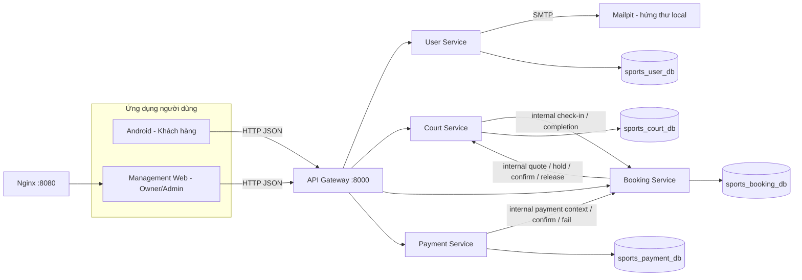
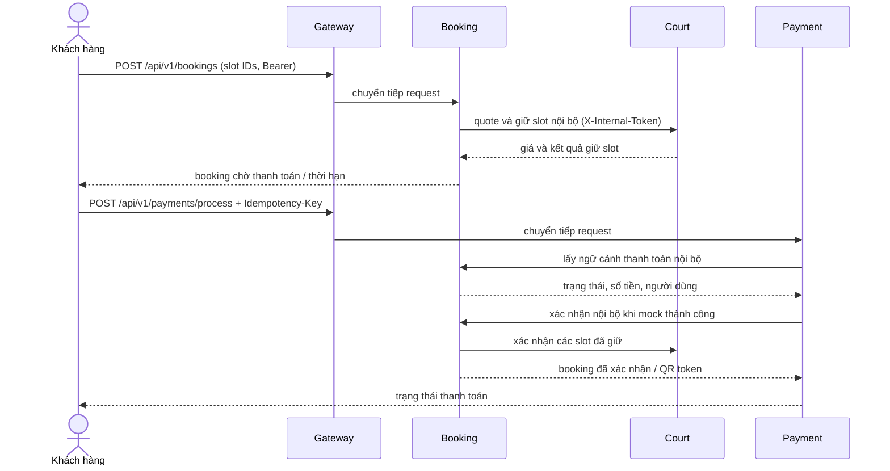
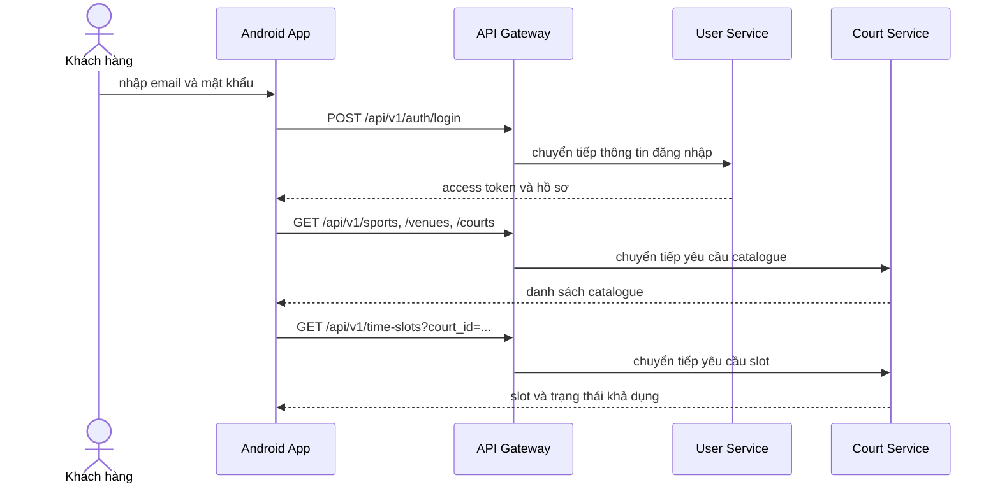
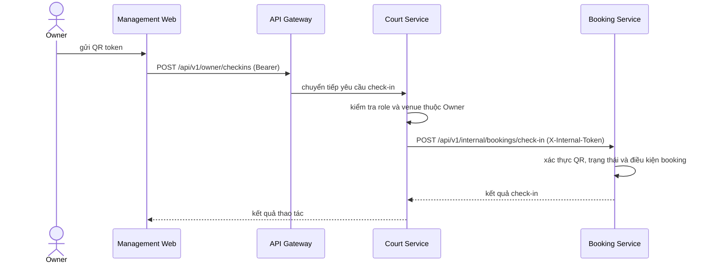
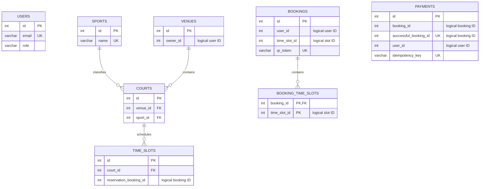
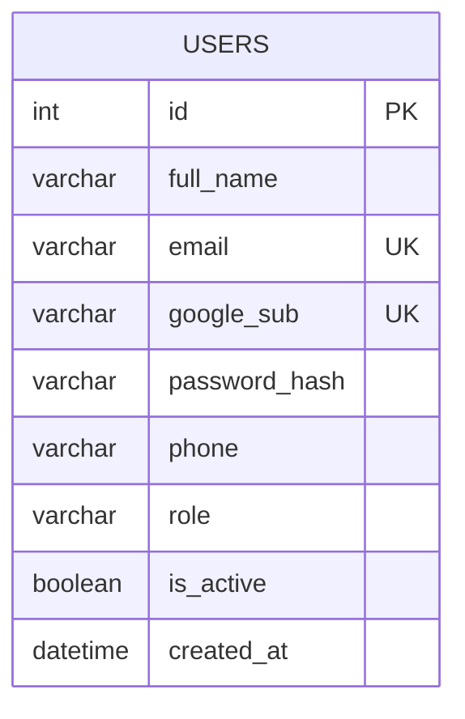
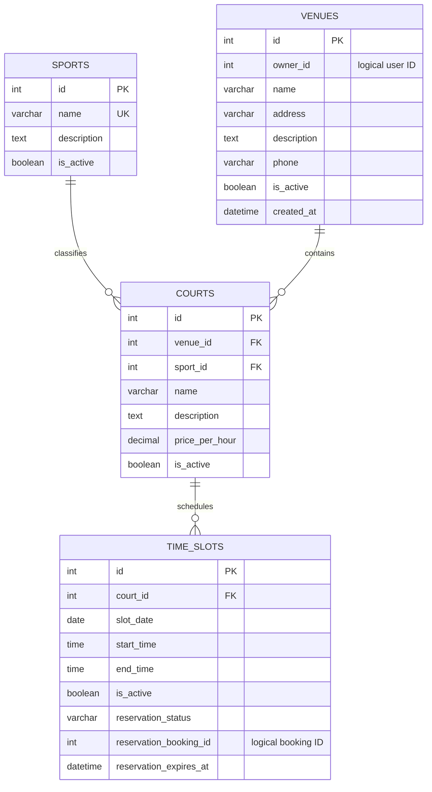
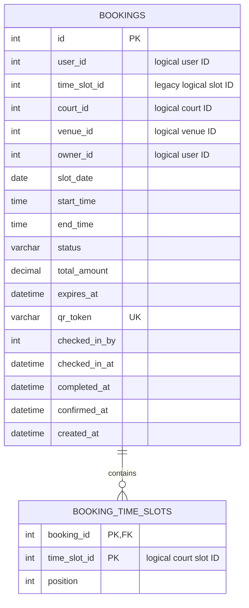
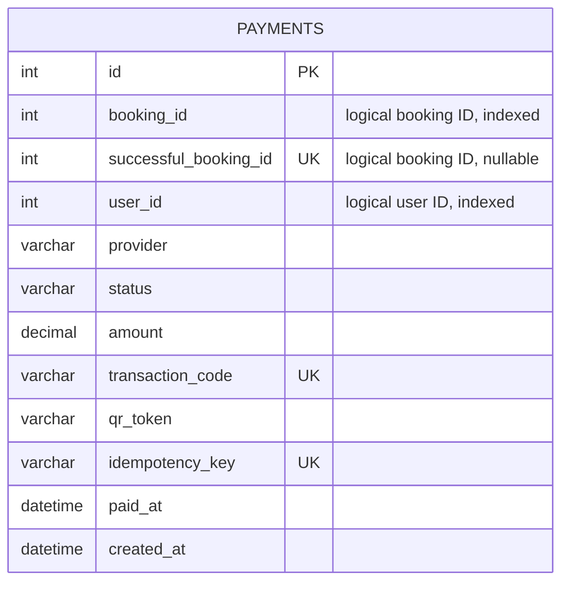

# Tài liệu kỹ thuật tổng hợp — Sports Court Booking

**Phạm vi:** mô tả mã nguồn trong repository và cấu hình phát triển local đã đọc khi biên soạn. Đây không phải cam kết production hay tuyên bố mọi luồng đã được chạy đầu cuối. Các nhãn **Đã triển khai**, **Một phần**, **Kế hoạch** và **Chưa kiểm chứng** phân biệt code, yêu cầu và bằng chứng chạy thực tế.

## Mục lục

1. [Tổng quan hệ thống và kiến trúc](#1-tổng-quan-hệ-thống-và-kiến-trúc)
2. [Yêu cầu chức năng](#2-yêu-cầu-chức-năng)
3. [Yêu cầu phi chức năng](#3-yêu-cầu-phi-chức-năng)
4. [Ca sử dụng và quy tắc nghiệp vụ](#4-ca-sử-dụng-và-quy-tắc-nghiệp-vụ)
5. [Thiết kế cơ sở dữ liệu và ERD](#5-thiết-kế-cơ-sở-dữ-liệu-và-erd)
6. [Hợp đồng API](#6-hợp-đồng-api)
7. [Xác thực và phân quyền](#7-xác-thực-và-phân-quyền)
8. [Triển khai và cấu hình](#8-triển-khai-và-cấu-hình)
9. [Chiến lược kiểm thử và bằng chứng](#9-chiến-lược-kiểm-thử-và-bằng-chứng)
10. [Giới hạn và hướng phát triển](#10-giới-hạn-và-hướng-phát-triển)
11. [Đối chiếu tài liệu đồ án](#11-đối-chiếu-tài-liệu-đồ-án)

## 1. Tổng quan hệ thống và kiến trúc

Sports Court Booking là ứng dụng đặt sân gồm ứng dụng Android cho khách hàng, Management Web cho Owner/Admin, API Gateway và bốn backend service dùng FastAPI. Cấu hình phát triển Docker Compose dùng MySQL 8.4 với bốn database/schema, Mailpit để hứng email local và Nginx phục vụ Management Web.

Management Web được phục vụ tại `http://127.0.0.1:8080`; cấu hình trình duyệt mặc định gọi Gateway tại `http://127.0.0.1:8000`. Gateway là điểm vào API công khai và định tuyến theo tiền tố `/api/v1`. Các lời gọi nội bộ dùng tên dịch vụ Docker và token nội bộ. Bốn schema có thể dùng chung một máy chủ MySQL trong môi trường phát triển này, nhưng mỗi schema thuộc một service riêng. ID trao đổi giữa các service là tham chiếu logic; không có khóa ngoại liên service hoặc transaction dùng chung.

### Thứ tự khởi động và phụ thuộc

Compose khai báo MySQL và Mailpit trước, tiếp theo là khởi tạo schema một lần, các service User/Court/Booking/Payment, demo seed một lần, Gateway rồi Management Web. Healthcheck là điều kiện khởi động cho service phụ thuộc. Helper chạy và kiểm tra từng giai đoạn riêng. Seed tự chạy trong setup lần đầu và khi Compose khởi chạy service `seed`; script được thiết kế idempotent. Điều này không chứng minh stack đã chạy thành công trên mọi máy.

### Trách nhiệm của các service

| Thành phần | Trách nhiệm | Dữ liệu sở hữu |
|---|---|---|
| API Gateway | Định tuyến API công khai, cung cấp health endpoint và proxy health của service, áp dụng CORS. | Không lưu dữ liệu. |
| User Service | Đăng ký/đăng nhập, JWT, hồ sơ, OTP đặt lại mật khẩu, Google ID token tùy chọn và quản lý user cho Admin. | `sports_user_db.users`. |
| Court Service | Sports, venues, courts, time slots, trạng thái giữ chỗ, adapter check-in cho Owner và thống kê catalogue cho Admin. | `sports_court_db`. |
| Booking Service | Báo giá, vòng đời booking, phối hợp giữ slot, giao diện dữ liệu Owner/Admin và API nội bộ booking. | `sports_booking_db`. |
| Payment Service | Giao dịch thanh toán mô phỏng, lịch sử của khách và báo cáo thanh toán Admin. | `sports_payment_db`. |
| Management Web | Giao diện trình duyệt cho Owner/Admin: catalogue, lịch, booking/check-in và màn hình quản trị. | Không truy cập DB trực tiếp; gọi Gateway. Một số khu vực có hiển thị demo/local. |
| Android | Đăng ký/đăng nhập khách hàng, catalogue, chọn giờ, booking, mock payment, lịch sử và hồ sơ. | Không truy cập DB trực tiếp; Retrofit gọi Gateway. |

## 2. Yêu cầu chức năng

| ID | Actor | Yêu cầu | Mô tả theo source | Trạng thái |
|---|---|---|
| FR-01 | Khách | Đăng ký/đăng nhập | Email/mật khẩu; phát hành access token. Đăng ký công khai tạo role `USER`, không nhận role từ ứng dụng khách. | Đã triển khai |
| FR-02 | Khách | Đăng nhập Google | Android lấy ID token; backend xác minh khi được bật/cấu hình. | Đã triển khai tùy chọn; đầu cuối chưa kiểm chứng |
| FR-03 | Khách | Đặt lại mật khẩu | User Service phát OTP và gửi qua SMTP; Compose mặc định dùng Mailpit. | Đã triển khai; gửi thư phụ thuộc SMTP |
| FR-04 | Khách | Xem/sửa hồ sơ | `GET/PATCH /api/v1/users/me`. | Đã triển khai |
| FR-05 | Khách | Duyệt sân và slot | Xem sports, venues, courts, time slots và trạng thái chọn được. | Đã triển khai |
| FR-06 | Owner/Admin | Quản lý danh mục/lịch | API quản lý môn thể thao, địa điểm, sân và slot có kiểm tra quyền/phạm vi. | Đã triển khai ở API; tích hợp UI tùy màn hình |
| FR-07 | Khách | Báo giá và giữ slot | Booking yêu cầu Court báo giá và giữ slot có thời hạn. | Đã triển khai |
| FR-08 | Khách | Tạo, xem, hủy booking và thanh toán mô phỏng | Backend kiểm tra chuyển trạng thái và điều kiện hủy. Payment hiện mô phỏng. | Đã triển khai |
| FR-09 | Owner | Xem booking, check-in QR, hoàn tất | Booking xác thực quyền sở hữu; Court chuyển tiếp thao tác nội bộ đến Booking. | Backend đã triển khai; tích hợp thực tế chưa kiểm chứng |
| FR-10 | Admin | Quản lý người dùng/danh mục/booking/check-in/báo cáo thanh toán | Các endpoint quản trị có kiểm tra role. | Đã triển khai ở API; từng màn hình cần đối chiếu riêng |
| FR-11 | Khách | Đánh giá sân sau booking | Có trong tài liệu yêu cầu nhưng chưa tìm thấy Review model/service/API. | Kế hoạch / chưa triển khai |
| FR-12 | Khách | Thanh toán thật | Không tìm thấy cổng thanh toán thật hoặc webhook; provider hiện tại là Mock. | Chưa triển khai |
| FR-13 | Vận hành | Triển khai production | Compose hiện là kiến trúc phát triển local, không phải cấu hình production. | Chưa có bằng chứng triển khai |

Các file trong `docs/requirements/` là tài liệu yêu cầu đầu vào, không phải bằng chứng mọi tính năng đã phát hành. Trạng thái implementation phải đối chiếu model, schema, route, client và test.

## 3. Yêu cầu phi chức năng

| Thuộc tính | Hiện trạng trong code | Giới hạn bằng chứng |
|---|---|---|
| Bảo mật | JWT Bearer, kiểm tra role/phạm vi Owner, `X-Internal-Token` cho lời gọi nội bộ. | Chưa thay thế đánh giá an toàn production và quản lý secret. |
| Mật khẩu | User DB lưu hash; response không trả hash. Seed dùng hash chuẩn cho account mới và giữ hash account fixture đã tồn tại khi chạy lại. | Chỉ dùng tài khoản demo trong môi trường local riêng. |
| Toàn vẹn dữ liệu | Mỗi service sở hữu schema riêng; Compose dùng chung một MySQL local với các schema tách biệt. | ID logic giữa service không có FK; không có distributed transaction ACID. |
| Nhất quán booking | Court và Booking phối hợp giữ slot qua HTTP; slot có unique constraint và trạng thái reservation. | Cần test tích hợp cạnh tranh và xử lý lỗi trên MySQL cô lập. |
| Idempotency payment | Ứng dụng khách gửi `Idempotency-Key`; DB có unique key và unique booking thanh toán thành công. | Đây là payment mô phỏng; chưa chứng minh idempotency với bộ xử lý thanh toán thật. |
| Health/readiness | Gateway/service có endpoint health; Compose có healthcheck; helper chờ hữu hạn và in tiến độ. | Health không chứng minh toàn bộ API hay kết nối mạng từ thiết bị. |
| CORS | Gateway chấp nhận origin HTTP(S) cụ thể và từ chối wildcard. | CORS không phải xác thực hoặc firewall. |
| Khả năng quan sát | Container logs và health checks. | Chưa tìm thấy tracing/metrics/log tập trung/production alerts. |
| Hiệu năng, độ sẵn sàng, mở rộng | Chưa có kết quả benchmark, SLO/SLA, HA, autoscaling hoặc load test. | Không nêu mục tiêu hiệu năng nếu chưa đo. |
| Khả năng bảo trì/tương thích | Bash/Batch gọi chung Python helper; Compose định nghĩa stack local; có test theo service. | Hệ điều hành, Docker Desktop, firewall và mạng Android phụ thuộc môi trường. |

## 4. Ca sử dụng và quy tắc nghiệp vụ

### UC-01 — Đăng ký và xác thực khách hàng

**Tác nhân:** khách chưa đăng nhập. **Điều kiện trước:** User Service sẵn sàng; email hợp lệ và chưa đăng ký. **Luồng chính:** gửi tên, email, mật khẩu, số điện thoại tùy chọn; service chuẩn hóa dữ liệu, băm mật khẩu, tạo role `USER`; đăng nhập trả bearer token và hồ sơ. **Luồng lỗi:** dữ liệu sai, email trùng, thông tin đăng nhập sai hoặc account bị vô hiệu hóa thì request bị từ chối. **Kết quả:** tạo account khách hoặc phát hành phiên truy cập. **API:** `POST /api/v1/auth/register`, `POST /api/v1/auth/login`. **Trạng thái:** có implementation; không hàm ý xác minh danh tính production.

### UC-02 — Duyệt catalogue và chọn khung giờ

**Tác nhân:** khách. **Điều kiện trước:** danh mục đang hoạt động. **Luồng chính:** xem môn thể thao/địa điểm/sân, lấy slot theo sân/ngày, yêu cầu báo giá cho một hoặc nhiều ID. **Luồng thay thế/lỗi:** ID không hợp lệ, slot bị vô hiệu hóa/đã giữ hoặc không thể báo giá thì không tiếp tục đặt được. **Quy tắc:** giờ tạo/sửa theo mốc 30 phút và giờ bắt đầu trước giờ kết thúc. **API:** `GET /api/v1/sports`, `/venues`, `/courts`, `/time-slots`; `GET /api/v1/booking-quotes/{slot_ids}`. **Kết quả:** danh sách slot và giá được Court xác nhận.

### UC-03 — Tạo booking và giữ slot

**Tác nhân:** khách đã xác thực. **Điều kiện trước:** ID slot dương, duy nhất, còn khả dụng; request nhận tối đa 24 ID. **Luồng chính:** Booking lấy báo giá, tạo booking `PENDING` rồi yêu cầu Court giữ slot. **Thời hạn giữ:** `BOOKING_HOLD_MINUTES`, mặc định Compose là 10 phút. **Luồng lỗi:** slot không còn trống trả conflict; service lỗi thì không trả kết quả tạo thành công. **API:** `POST /api/v1/bookings`. **Kết quả:** booking chờ thanh toán có thời hạn; các service không dùng một transaction DB chung.

### UC-04 — Thanh toán booking mô phỏng

**Tác nhân:** khách sở hữu booking đã xác thực. **Điều kiện trước:** booking có thể thanh toán và thời gian giữ chưa hết hạn. **Luồng chính:** gửi booking ID và `Idempotency-Key`; Payment lấy ngữ cảnh nội bộ, ghi payment mô phỏng và khi thành công yêu cầu Booking xác nhận. **Kết quả:** payment lưu `PAID`, booking được xác nhận và tạo QR token. **Luồng thử lại:** dùng lại key để nhận kết quả idempotent của lần thử; lần thử mới cần key mới khi lần cũ đã kết thúc. Không có tiền thật được chuyển. **API:** `POST /api/v1/payments/process`.

### UC-05 — Xem hoặc hủy booking của mình

**Tác nhân:** khách đã xác thực. **Luồng chính:** xem danh sách/chi tiết booking của mình; hủy booking `PENDING` hoặc booking `CONFIRMED` trong 30 phút sau `confirmed_at`. **Luồng lỗi:** không lộ booking người khác; trạng thái không hợp lệ trả conflict; booking cũ thiếu `confirmed_at` không hủy được theo nhánh này. **API:** `GET /api/v1/bookings`, `GET /api/v1/bookings/{id}`, `POST /api/v1/bookings/{id}/cancel`. **Kết quả:** booking chuyển trạng thái và Court được yêu cầu nhả slot khi cần.

### UC-06 — Owner check-in và hoàn tất booking

**Tác nhân:** Owner đã xác thực. **Điều kiện trước:** booking thuộc venue của Owner, QR và trạng thái hợp lệ. **Luồng chính:** Owner gửi QR; Court xác thực Owner rồi gọi Booking nội bộ; booking đủ điều kiện chuyển `CHECKED_IN`; Owner hoàn tất để chuyển `COMPLETED`. **Luồng lỗi:** QR sai/đã dùng, booking không thuộc Owner hoặc sai trạng thái thì bị từ chối. **API:** `POST /api/v1/owner/checkins`, `GET /api/v1/owner/bookings`, `POST /api/v1/owner/bookings/{id}/complete`. **Trạng thái:** API có trong source; lượt tài liệu này chưa kiểm thử trên stack/thiết bị thực.

### UC-07 — Admin xem và quản lý dữ liệu

**Tác nhân:** Admin đã xác thực. User Service có API thống kê/danh sách/chi tiết/trạng thái user; Court có thống kê danh mục; Booking có thống kê/danh sách/chi tiết/check-in; Payment có báo cáo. **Luồng lỗi:** backend từ chối nếu role không đủ quyền. **Kết quả:** Admin xem/cập nhật đúng phạm vi quyền. Từng màn hình UI cần được kiểm tra riêng để xác định có gọi API hay chỉ hiển thị demo.

### Ghi chú trạng thái Booking/Payment

- Trạng thái booking trong code hiện tại gồm `PENDING`, `CONFIRMED`, `CHECKED_IN`, `COMPLETED`, `CANCELLED`, `FAILED` và `EXPIRED`.
- Hold `PENDING` hết hạn theo thời điểm đã lưu. Booking có endpoint expiry nội bộ và kiểm tra expiry trong một số request. Compose không khai báo scheduler định kỳ gọi endpoint; tự động quét hết hạn theo lịch **chưa được xác nhận**.
- Payment hỗ trợ các nhánh trạng thái chờ/thành công/thất bại; bản ghi mock thành công dùng `PAID`. Mặc định provider là `MOCK`.
- Khi chạy seed lại, account khớp fixture giữ nguyên password hash. Migration email fixture cũ (nếu khớp) cập nhật email ngay trên bản ghi hiện có và giữ nguyên ID, do đó các tham chiếu tới User ID không đổi. Việc này không phải đặt lại mật khẩu. Danh tính fixture được khai báo trong `backend/database/seed.sql`.
- Seed tạo một Admin, bốn Owner, mười hai Customer cùng dữ liệu demo về môn thể thao, địa điểm, sân và khung giờ. Account demo mới được thêm dùng mật khẩu `password123`; chạy seed lại không đặt lại password hash của account đã tồn tại. Chỉ dùng trong môi trường phát triển.

### Sơ đồ tuần tự — booking và thanh toán mô phỏng

Sơ đồ thể hiện chiều gọi theo implementation; không khẳng định có distributed transaction hoặc đã chạy thử runtime.

### Sơ đồ tuần tự — đăng nhập và duyệt sân

### Sơ đồ tuần tự — check-in QR của Owner

Các sơ đồ này mô tả luồng được hỗ trợ bởi route hiện tại. Chúng không phải bằng chứng đã chạy trên hạ tầng triển khai.

## 5. Thiết kế cơ sở dữ liệu và ERD

Compose khởi tạo bốn schema: `sports_user_db`, `sports_court_db`, `sports_booking_db` và `sports_payment_db`. Các bảng dưới đây lấy theo SQLAlchemy model hiện tại và các revision Alembic của User Service. `PK` là khóa chính; `FK` là khóa ngoại vật lý trong cùng schema; `logical` là ID trao đổi giữa service mà không có khóa ngoại trong database. MySQL có thể biểu diễn kiểu Boolean vật lý là `TINYINT(1)`.

### ERD tổng thể

ERD này gồm các entity của từng service nhưng chỉ vẽ **quan hệ vật lý**. Các tham chiếu logic giữa service gồm: `venues.owner_id -> users.id`; `time_slots.reservation_booking_id -> bookings.id`; `bookings.user_id -> users.id`; `bookings.time_slot_id` và `booking_time_slots.time_slot_id -> time_slots.id`; `payments.booking_id`, `payments.successful_booking_id -> bookings.id`; `payments.user_id -> users.id`. Service phối hợp các tham chiếu này bằng logic ứng dụng; chúng không phải ràng buộc khóa ngoại.

### ERD theo từng service

### Danh mục bảng và ràng buộc

| Service/bảng | Cột và quy tắc khóa trong model/migration hiện tại |
|---|---|
| User `users` | `id` integer PK tự tăng; `full_name` varchar(150) bắt buộc; `email` varchar(255) bắt buộc, duy nhất; `google_sub` varchar(255) nullable, duy nhất; `password_hash` varchar(255) bắt buộc; `phone` varchar(20) nullable; `role` varchar(20) bắt buộc, check `USER/OWNER/ADMIN`; `is_active` boolean bắt buộc; `created_at` datetime có múi giờ, mặc định thời gian máy chủ. |
| Court `sports` | `id` integer PK; `name` varchar(100) bắt buộc, duy nhất; `description` text nullable; `is_active` boolean bắt buộc, mặc định true. |
| Court `venues` | `id` integer PK; `owner_id` integer bắt buộc, là User ID logic; `name` varchar(200) và `address` varchar(255) bắt buộc; `description` text và `phone` varchar(20) nullable; `is_active` boolean mặc định true; `created_at` datetime bắt buộc. |
| Court `courts` | `id` integer PK; `venue_id` FK tới `venues.id`; `sport_id` FK tới `sports.id`; `name` varchar(100) bắt buộc; `description` nullable; `price_per_hour` decimal(12,2) bắt buộc; `is_active` boolean mặc định true. |
| Court `time_slots` | `id` integer PK; `court_id` FK tới `courts.id`; ngày, giờ bắt đầu/kết thúc bắt buộc; `is_active` boolean mặc định true; trạng thái giữ varchar(10) mặc định `AVAILABLE`; `reservation_booking_id` và `reservation_expires_at` nullable; unique `(court_id, slot_date, start_time, end_time)`; index `(reservation_status, reservation_expires_at)`. |
| Booking `bookings` | `id` integer PK; `user_id` logic bắt buộc, `time_slot_id` legacy có index; `court_id`, `venue_id`, `owner_id`, `slot_date`, `start_time`, `end_time` logic nullable; `status` varchar(20) mặc định `PENDING`; amount decimal(12,2) bắt buộc; thời hạn và timestamp vòng đời nullable; QR token varchar(128) nullable, duy nhất; ID người check-in nullable; `created_at` mặc định thời gian máy chủ. |
| Booking `booking_time_slots` | `booking_id` FK tới `bookings.id`, cascade delete và là một phần composite PK; `time_slot_id` integer là ID Court logic, có index và là phần còn lại của composite PK; `position` integer mặc định 0. |
| Payment `payments` | `id` integer PK; `booking_id` và `user_id` logic bắt buộc, có index; `successful_booking_id` logic nullable, duy nhất; provider varchar(30) mặc định `MOCK`; status varchar(20) mặc định `PENDING`; amount decimal(12,2); transaction code varchar(100) nullable, duy nhất; QR token varchar(128) nullable; idempotency key varchar(100) bắt buộc, duy nhất; `paid_at` nullable; `created_at` mặc định thời gian máy chủ. |

Khởi tạo Court, Booking và Payment kiểm tra object schema hiện có, đối chiếu với model rồi mới tạo bảng; nếu không khớp thì dự kiến dừng thay vì âm thầm đổi schema. User schema được quản lý bằng Alembic. Đây là mô tả từ code; tài liệu này không kiểm tra database của người dùng.

Các sơ đồ ảnh trong repository được giữ làm tư liệu bổ sung/lịch sử: [ERD tổng thể](diagrams/erd/overall_erd.png), [kiến trúc](diagrams/architecture/microservice_SportBooking.png), [use case](diagrams/usecase/system_usecase.png), [hoạt động booking/payment](diagrams/activity/booking_payment.png) và [tuần tự booking/payment](diagrams/sequence/booking_payment.png). Nếu sơ đồ ảnh khác source, model và migration là căn cứ ưu tiên.

## 6. Hợp đồng API

Địa chỉ API công khai mặc định trong Compose local là `http://127.0.0.1:8000`; endpoint nghiệp vụ dùng tiền tố `/api/v1`. Gateway chỉ chuyển tiếp các tiền tố khai báo trong `backend/gateway/main.py`, đồng thời chuyển tiếp header xác thực/nội dung và query string; đường dẫn không khớp trả `404`. Timeout upstream là 10 giây; lỗi kết nối/timeout trả `503`/`504`. OpenAPI tương tác có tại `/docs` khi Gateway chạy. Nếu không ghi khác, endpoint được bảo vệ yêu cầu `Authorization: Bearer <access_token>`.

### Endpoint kiểm tra sức khỏe qua Gateway

| Method/đường dẫn | Quyền | Kết quả |
|---|---|---|
| `GET /health` | Công khai | Phản hồi liveness Gateway `{service, status}`. |
| `GET /api/v1/user/health` | Proxy công khai | Health User Service. |
| `GET /api/v1/court/health` | Proxy công khai | Health Court Service. |
| `GET /api/v1/booking/health` | Proxy công khai | Health Booking Service. |
| `GET /api/v1/payment/health` | Proxy công khai | Health Payment Service. |

### API công khai của User Service

| Phương thức/đường dẫn | Quyền | Nội dung/query | Phản hồi/tác động |
|---|---|---|---|
| `POST /api/v1/auth/register` | Công khai | `UserCreate`: `full_name`, `email`, `password`, `phone` tùy chọn; không nhận trường ngoài schema. | `UserResponse`, tạo role `USER`; không trả password hash. |
| `POST /api/v1/auth/login` | Công khai | `email`, `password`. | `TokenResponse`: access token, loại token, thời hạn giây và user. |
| `POST /api/v1/auth/google` | Công khai khi đã cấu hình | Google `id_token`. | `TokenResponse`; không khả dụng khi Google Login bị tắt/chưa cấu hình. |
| `POST /api/v1/auth/forgot-password` | Công khai | `email`. | Khởi tạo gửi OTP; phản hồi tổng quát để hạn chế dò tài khoản. |
| `POST /api/v1/auth/reset-password` | Công khai | `email`, `otp_code` sáu ký tự, `new_password`. | Đổi mật khẩu nếu OTP hợp lệ. |
| `GET /api/v1/users/me` | Cần xác thực | Bearer token. | `UserResponse` của tài khoản hiện tại. |
| `PATCH /api/v1/users/me` | Cần xác thực | `full_name`, `phone` tùy chọn; không nhận trường ngoài schema. | `UserResponse` đã cập nhật. |
| `GET /api/v1/admin/users/summary` | ADMIN | Không có. | Thống kê tổng hợp user/owner. |
| `GET /api/v1/admin/users` | ADMIN | Tham số phân trang/lọc theo route schema. | `items`, `total`, `page`, `page_size`. |
| `GET /api/v1/admin/users/{user_id}` | ADMIN | User ID trên URL. | `UserResponse`. |
| `PATCH /api/v1/admin/users/{user_id}/status` | ADMIN | `{is_active: boolean}`. | User sau khi cập nhật. |

Email được trim và chuyển thành chữ thường; schema tạo user/đặt lại mật khẩu yêu cầu mật khẩu dài 8–128 ký tự. Chi tiết mã lỗi và validation HTTP theo FastAPI và logic route.

### API công khai của Court Service

| Phương thức/đường dẫn | Quyền | Nội dung/query | Phản hồi/tác động |
|---|---|---|---|
| `GET /api/v1/sports`, `/sports/{sport_id}` | Công khai | Danh sách có thể lọc `is_active`. | Danh sách/chi tiết môn thể thao. |
| `GET /api/v1/venues`, `/venues/{venue_id}` | Công khai | Bộ lọc danh sách theo route. | Danh sách/chi tiết địa điểm công khai. |
| `GET /api/v1/courts`, `/courts/{court_id}` | Công khai | Bộ lọc venue/sport/active tùy chọn. | Danh sách/chi tiết sân. |
| `GET /api/v1/time-slots`, `/time-slots/{slot_id}` | Công khai | Danh sách nhận/lọc `court_id`, có thể lọc `slot_date`, `is_active` theo route. | Danh sách/chi tiết slot và trạng thái giữ/chọn được. |
| `POST/PUT/DELETE /api/v1/sports[/{sport_id}]` | ADMIN | `SportInput` khi tạo/cập nhật; ID trên URL khi xóa. | Kết quả tạo/cập nhật; xóa trả `204`. |
| `POST/PUT/DELETE /api/v1/venues[/{venue_id}]` | OWNER hoặc ADMIN có phạm vi | `VenueInput` khi ghi; ID trên URL khi xóa. | Kết quả venue; thao tác Owner giới hạn ở venue được sở hữu. Xóa trả `204`. |
| `POST/PUT/DELETE /api/v1/courts[/{court_id}]` | OWNER hoặc ADMIN có phạm vi | `CourtInput`: venue, sport, tên, giá và các trường tùy chọn. | Kết quả sân; xóa trả `204`. |
| `POST/PUT/DELETE /api/v1/time-slots[/{slot_id}]` | OWNER hoặc ADMIN có phạm vi | `TimeSlotInput`: sân, ngày, giờ bắt đầu/kết thúc; có kiểm tra mốc và khoảng giờ. | Kết quả slot; xóa trả `204`. |
| `GET /api/v1/management/catalogue/venues[/{id}]` | OWNER/ADMIN | Bộ lọc tùy chọn. | Dữ liệu quản lý giới hạn theo phạm vi quyền. |
| `GET /api/v1/management/catalogue/courts[/{id}]` | OWNER/ADMIN | Bộ lọc venue tùy chọn. | Dữ liệu quản lý giới hạn theo phạm vi quyền. |
| `GET /api/v1/management/catalogue/time-slots[/{id}]` | OWNER/ADMIN | Bộ lọc court/ngày tùy chọn. | Dữ liệu quản lý giới hạn theo phạm vi quyền. |
| `GET /api/v1/admin/catalogue/summary` | ADMIN | Không có. | Số liệu tổng hợp catalogue. |
| `POST /api/v1/owner/checkins` | OWNER | `{qr_token}` (32–128 ký tự). | Gọi thao tác check-in của Booking Service. |

`SportInput`, `VenueInput`, `CourtInput` và `TimeSlotInput` từ chối trường không được khai báo. Giờ bắt đầu/kết thúc slot phải nằm trên mốc 30 phút và giờ bắt đầu phải sớm hơn giờ kết thúc. Giá trị mặc định query và phản hồi validation chi tiết được định nghĩa trong route/schema.

### API công khai của Booking Service

| Phương thức/đường dẫn | Quyền | Nội dung/query | Phản hồi/tác động |
|---|---|---|---|
| `GET /api/v1/booking-quotes/{slot_ids}` | Khách đã xác thực | ID slot được phân tách bằng dấu phẩy trên URL. | Báo giá/slot do Court Service trả về. |
| `POST /api/v1/bookings` | Khách đã xác thực | Chỉ một trong `time_slot_id` hoặc `time_slot_ids`; danh sách tối đa 24 ID dương, duy nhất. | Booking chờ thanh toán gồm tổng tiền, slot và thời hạn. |
| `GET /api/v1/bookings` | Khách đã xác thực | Không có. | Booking của khách hiện tại. |
| `GET /api/v1/bookings/{booking_id}` | Khách đã xác thực | Booking ID. | Chỉ booking của chính khách. |
| `POST /api/v1/bookings/{booking_id}/cancel` | Khách đã xác thực | Booking ID. | Hủy nếu trạng thái/thời điểm cho phép; nếu không trả conflict. |
| `GET /api/v1/owner/bookings` | OWNER | Các bộ lọc Owner được route hỗ trợ. | Booking trong phạm vi Owner. |
| `GET /api/v1/owner/bookings/{booking_id}` | OWNER | Booking ID. | Chỉ trả booking thuộc venue của Owner. |
| `POST /api/v1/owner/bookings/{booking_id}/complete` | OWNER | Booking ID. | Phản hồi hoàn tất nếu đủ điều kiện. |
| `GET /api/v1/admin/bookings/summary` | ADMIN | Không có. | Thống kê booking tổng hợp. |
| `GET /api/v1/admin/bookings` | ADMIN | Phân trang và bộ lọc theo route. | Danh sách Admin có phân trang. |
| `GET /api/v1/admin/bookings/{booking_id}` | ADMIN | Booking ID. | Chi tiết booking cho Admin. |
| `GET /api/v1/admin/checkins` | ADMIN | Bộ lọc/phân trang theo route. | Danh sách booking liên quan check-in. |

### API công khai của Payment Service

| Phương thức/đường dẫn | Quyền | Nội dung/query | Phản hồi/tác động |
|---|---|---|---|
| `POST /api/v1/payments/process` | Khách đã xác thực | Nội dung thanh toán booking và header `Idempotency-Key`. | Tạo/phát lại kết quả thanh toán mô phỏng và phối hợp xác nhận booking. |
| `GET /api/v1/payments` | Khách đã xác thực | Không có. | Các payment của chính khách. |
| `GET /api/v1/payments/{payment_id}` | Khách đã xác thực | Payment ID. | Chỉ payment của chính khách. |
| `GET /api/v1/payments/report` | ADMIN | Query ngày/khoảng/bộ lọc theo route. | Báo cáo tổng hợp; ngữ cảnh booking lấy qua lời gọi nội bộ. |

### API nội bộ (không gọi trực tiếp từ ứng dụng khách)

Theo thiết kế hiện tại, các route này chỉ dùng trong network service và xác thực `X-Internal-Token` tại endpoint tương ứng. Liệt kê để giải thích tích hợp; Android và trình duyệt không gọi trực tiếp.

| Route | Bên gọi/tác dụng |
|---|---|
| Court `GET /api/v1/internal/slots/{slot_ids}/quote` | Booking lấy báo giá slot có thẩm quyền. |
| Court `POST /api/v1/internal/slots/{slot_ids}/hold?booking_id=...` | Booking yêu cầu giữ slot có thời hạn. |
| Court `POST /api/v1/internal/slots/{slot_ids}/confirm?booking_id=...` | Booking xác nhận slot đã giữ sau khi thanh toán thành công. |
| Court `POST /api/v1/internal/slots/{slot_ids}/release?booking_id=...` | Booking nhả slot khi hủy/thất bại/hết hạn. |
| Booking `/api/v1/internal/bookings/{id}/payment-context`, `/confirm`, `/fail` | Payment đọc điều kiện thanh toán và báo kết quả mô phỏng. |
| Booking `POST /api/v1/internal/bookings/payment-report-context` | Payment report lấy ngữ cảnh booking/Owner. |
| Booking `POST /api/v1/internal/bookings/check-in`, `/{id}/complete`, `/expire` | Adapter Court gọi các thao tác vòng đời nội bộ của Booking. |

Gateway không ánh xạ `/api/v1/internal` ra API công khai; client không được gọi các route này. OpenAPI đầy đủ ở Gateway `/docs`; các file contract cũ được giữ lại và có thể chứa đề xuất lịch sử. `routes.py`, `schemas.py`, model và route map của Gateway là căn cứ hợp đồng hiện tại.

## 7. Xác thực và phân quyền

- User Service xác thực bằng mật khẩu và phát hành JWT Bearer. Biến Compose liên quan gồm `JWT_SECRET_KEY`, `JWT_ALGORITHM` (mặc định `HS256`) và `JWT_ACCESS_TOKEN_EXPIRE_MINUTES` (mặc định 60).
- Các dependency của service kiểm tra danh tính từ access token. Backend thực thi trạng thái account và role; ẩn nút trên giao diện không thay thế phân quyền.
- Các role là `USER`, `OWNER`, `ADMIN`. Đăng ký công khai tạo `USER`; người dùng không tự chọn role quản trị khi đăng ký.
- Endpoint Court/Booking giới hạn theo Owner xác minh venue/booking thuộc Owner đang đăng nhập.
- Lời gọi HTTP nội bộ gửi `X-Internal-Token` lấy từ `INTERNAL_SERVICE_TOKEN`. Không đưa token này vào mã Android hoặc trình duyệt.
- Google Login là tùy chọn. Backend xác minh ID token theo audience đã cấu hình; Client ID không phải Client Secret. Tài liệu này không khẳng định flow Google thật đã được kiểm thử.
- Đặt lại mật khẩu dùng OTP qua email. Mailpit hứng thư local. Chọn Gmail SMTP có thể gửi thư thật và cần cấu hình chủ động.
- API dùng response model tường minh; `UserResponse` không chứa password hash.

## 8. Triển khai và cấu hình

### Môi trường phát triển local

Cần Docker Engine/Desktop với Compose v2, Python 3.10+ cho helper/test backend, JDK/Android Studio tương thích Gradle Wrapper khi build Android. Launcher `setup.bat` và `setup.sh` chọn Python rồi gọi chung `setup_config.py`. Helper chuẩn bị/dùng lại `backend/.venv`, kiểm tra Docker, kiểm tra root `.env`, xác thực Compose và cổng; sau đó khởi động/chờ MySQL/Mailpit, schema, backend, seed, Gateway và Management Web. Nếu chưa có `.env`, helper sao chép `.env.example`, tạo secret local sau khi kiểm tra volume và hỏi lựa chọn SMTP/Google. Nếu `.env` đã có và hợp lệ, mặc định helper giữ nguyên; khi thiếu secret bắt buộc, helper có thể bổ sung sau khi kiểm tra volume, hoặc cập nhật biến setup quản lý nếu người dùng chọn cập nhật. Các mục `.env` khác được giữ nguyên. Mỗi giai đoạn chờ health tối đa 720 giây, mỗi lệnh Compose tối đa 900 giây; do các giai đoạn chạy tuần tự, tổng thời gian có thể dài hơn. Setup không yêu cầu Android API IP.

Compose dùng named volume `sport-court-booking-mysql-dev` và `sport-court-booking-mailpit-dev`. Dừng/xóa container khác với xóa volume. Không xóa volume như bước xử lý lỗi thông thường.

### Biến cấu hình

Không lưu secret thật trong tài liệu. Root `.env` dùng cho Compose. `backend/.env.example` là mẫu riêng cho một số cách chạy backend trực tiếp, không thay thế file cấu hình Compose ở root.

| Biến | Mục đích |
|---|---|
| `MYSQL_DEV_ROOT_PASSWORD` | Thông tin xác thực MySQL local. |
| `JWT_SECRET_KEY`, `JWT_ALGORITHM`, `JWT_ACCESS_TOKEN_EXPIRE_MINUTES` | Khóa ký token, thuật toán và thời hạn. |
| `INTERNAL_SERVICE_TOKEN` | Xác thực lời gọi giữa các backend service. |
| `SMTP_PROVIDER`, `SMTP_HOST`, `SMTP_PORT`, `SMTP_USERNAME`, `SMTP_PASSWORD`, `SMTP_FROM`, `SMTP_STARTTLS` | Mailpit hoặc Gmail SMTP tùy chọn. |
| `GOOGLE_LOGIN_ENABLED`, `GOOGLE_CLIENT_ID`, biến nhận diện OAuth Android | Cấu hình Google Login tùy chọn. |
| `GATEWAY_BIND_ADDRESS`, `GATEWAY_HOST_PORT` | Địa chỉ bind và cổng công khai trên host. Compose fallback là `127.0.0.1:8000`; `.env.example` của dự án đặt `0.0.0.0:8000` để hỗ trợ truy cập LAN. |
| `CORS_ALLOWED_ORIGINS` | Danh sách origin trình duyệt được phép, khai báo cụ thể. |
| `BOOKING_HOLD_MINUTES` | Thời gian giữ slot chờ thanh toán; mặc định Compose là 10 phút. |

Gateway trong container lắng nghe `0.0.0.0:8000`; Compose ánh xạ `${GATEWAY_BIND_ADDRESS:-127.0.0.1}:${GATEWAY_HOST_PORT:-8000}:8000`. Điện thoại thật cần bind host `0.0.0.0`; Android dùng IPv4 LAN thật của laptop, không dùng `0.0.0.0`. Nếu cần, chỉ cho phép TCP 8000 trên firewall profile Private. Health endpoint là `GET /health`.

### URL API cho Android

`android-user/app/build.gradle.kts` khai báo mặc định BuildConfig `API_BASE_URL`. `ApiClient.java` truyền `BuildConfig.API_BASE_URL` vào Retrofit. Có thể override lúc build bằng `-PAPI_BASE_URL=...`. Emulator dùng `http://10.0.2.2:8000/`; điện thoại qua Wi-Fi LAN dùng `http://<LAPTOP_LAN_IP>:8000/`. USB dùng cài/debug, không tự định tuyến API qua cáp. Hướng dẫn setup, kiểm tra LAN và Android nằm trong [README](../README.md#chạy-android-customer-app).

Launcher Docker Compose (`setup.bat`/`setup.sh`) không gọi workflow host-run `backend/scripts/setup_local.py`. Script host-run này là tiện ích riêng để khởi tạo database theo cấu hình được cung cấp; chỉ cân nhắc sau khi đọc và xác nhận target database, đặc biệt không chạy trên dữ liệu cần giữ. Compose setup vẫn là đường chạy local được README hướng dẫn.

### Phân biệt lệnh dừng và xóa dữ liệu

- `docker compose --profile dev stop` dừng container, giữ container và named volume.
- `docker compose --profile dev down` xóa container/network của Compose nhưng mặc định giữ named volume.
- `docker compose --profile dev down -v` xóa thêm named volume đã khai báo và có thể xóa vĩnh viễn dữ liệu MySQL/Mailpit local. Chỉ dùng sau khi đã quyết định bỏ dữ liệu và xác minh đúng project/volume.

Việc đọc tài liệu không chạy các lệnh lifecycle này.

## 9. Chiến lược kiểm thử và bằng chứng

### Các loại kiểm thử trong repository

| Tầng | Kiểm thử/xác minh có trong repository | Có thể chứng minh |
|---|---|---|
| Backend | Pytest cho xác thực, booking, payment, phân quyền, Owner check-in, khởi tạo/cấu hình database, seed và helper setup. | Hành vi unit/route trong fixture test; chỉ chứng minh tích hợp MySQL nếu test dùng MySQL cô lập thật. |
| Management Web | Node test runner tích hợp sẵn (`management-web/tests/*.test.js`). | Tiện ích JS và hành vi UI/API mà từng test bao phủ. |
| Android | JUnit local và khung instrumentation test; Gradle Wrapper. | Unit test local không tương đương chạy trên điện thoại; instrumentation cần Android runtime. |
| Compose | `docker compose --profile dev config --quiet`. | Kiểm tra YAML/nội suy cấu hình hiện tại; không khởi động container hoặc chứng minh health. |
| Tích hợp thủ công | Health endpoint, tài liệu Gateway và request từ thiết bị/trình duyệt. | Cần ghi môi trường/mạng đích để xác nhận tích hợp runtime. |

Các kịch bản thủ công nên chạy trên môi trường local cô lập: đăng ký/đăng nhập và khôi phục mật khẩu; xem catalogue; tạo booking, thử mock payment thành công/thất bại; kiểm tra quyền truy cập theo vai trò; kiểm tra Owner check-in/completion; và gọi Gateway từ Android emulator/thiết bị LAN. Đây là danh sách gợi ý kiểm tra, không phải kết quả đã đạt. Không chạy thao tác ghi dữ liệu trên database cần giữ.

### Kết quả kiểm tra trong task này

| Kiểm tra | Kết quả | Phạm vi |
|---|---|---|
| Cú pháp Bash (`bash -n setup.sh`) | **PASS** trong lượt kiểm tra này. | Dùng Bash của Git for Windows; chỉ kiểm tra cú pháp, không chạy setup. |
| Setup helper pytest (`tests/test_setup_config.py`) | **PASS: 69 passed** trong lượt kiểm tra này. | Có test URL Gradle/Retrofit không phụ thuộc IP LAN cá nhân và test không ghi đè `.env` có sẵn. |
| Management Web (`node --test tests/*.test.js`) | **PASS: 94 passed, 0 failed** trong lượt kiểm tra này. | Chạy Node test runner từ thư mục `management-web`. |
| Compose config quiet (`docker compose --profile dev config --quiet`) | **PASS, mã thoát 0** trong lượt kiểm tra này. | Có cảnh báo Docker không đọc được cấu hình người dùng; không container nào được khởi động. Đây không phải bằng chứng runtime. |
| `git diff --check` | **PASS** trong lượt kiểm tra này. | Chỉ kiểm tra whitespace; có cảnh báo line ending trên một số file working tree. |
| Health runtime, thiết bị Android, email, Google OAuth, seed SQL trên DB cô lập, toàn bộ Backend suite | **CHƯA KIỂM THỬ** trong lượt này. | Không tuyên bố stack hoặc database đã chạy thành công. |

Kết quả là snapshot của những lệnh ghi trong bảng; không có nghĩa toàn bộ suite đã chạy. Trước khi nộp, chạy test phù hợp trong môi trường cô lập và lưu lệnh/runtime/output chính xác. Không chạy seed lên database người dùng. README hướng dẫn các lệnh test và kiểm tra cơ bản; các kịch bản tạo booking hoặc thay đổi dữ liệu chỉ nên chạy trên database local cô lập và kết quả cần được ghi nhận sau khi chạy thật.

## 10. Giới hạn và hướng phát triển

1. **Thanh toán thật:** chỉ thay provider mô phỏng bằng tích hợp đã được rà soát, có xác thực callback/chữ ký, idempotency, đối soát và xử lý lỗi.
2. **Tác vụ hết hạn:** thiết kế và vận hành job định kỳ cho booking; endpoint/kiểm tra theo request hiện tại không chứng minh Compose có scheduler đang chạy.
3. **Nhất quán liên service:** chuẩn hóa retry, outbox/compensation và khả năng quan sát cho lời gọi Booking–Court và Payment–Booking; bổ sung test tích hợp cô lập và cạnh tranh.
4. **Đánh giá sân:** chỉ triển khai sau khi xác định yêu cầu, phân quyền, kiểm duyệt và lưu trữ; chưa thấy model/API backend tương ứng.
5. **Vận hành production:** bổ sung ingress TLS, quản lý secret, diễn tập backup/restore, rollout migration, monitoring/log tập trung và rà soát an toàn triển khai.
6. **Tích hợp giao diện:** gắn nhãn demo/sample rõ ràng và đối chiếu từng màn hình Owner/Admin với API thật trước khi khẳng định dữ liệu được lưu.
7. **Kết nối thiết bị:** LAN IP, firewall riêng tư, Wi-Fi client isolation và mạng Docker Desktop tùy host; chỉ đọc source không thể xác nhận kết nối mạng.
8. **Tái lập kiểm thử:** ghi phiên bản MySQL/Android/toolchain cô lập và kết quả thực chạy thay vì suy ra từ file test.

## 11. Ánh xạ nội dung sang báo cáo đồ án

Có thể dùng cấu trúc này làm nền cho báo cáo đồ án nhưng phải giữ rõ trạng thái implementation. Gợi ý ánh xạ:

| Chương báo cáo | Section tương ứng | Nội dung nhóm cần bổ sung từ kết quả đã xác minh |
|---|---|---|
| Giới thiệu và phạm vi | 1, 2 | Bổ sung bài toán, mục tiêu, người dùng đích và giới hạn dự án đã được nhóm thống nhất. |
| Phân tích yêu cầu | 2, 4 | Bổ sung yêu cầu/tiêu chí chấp nhận đã duyệt; tách riêng đề xuất. |
| Kiến trúc và thiết kế | 1, 5, 7 | Bổ sung lý do chọn kiến trúc, bối cảnh triển khai và sơ đồ đã được rà soát. |
| Hiện thực | 6, 7, 8 | Bổ sung ảnh chụp, walkthrough code và chi tiết phiên bản/cấu hình phát hành. |
| Kiểm thử và đánh giá | 9 | Bổ sung ngày chạy, môi trường, độ bao phủ và kịch bản thủ công đã thực hiện. |
| Giới hạn và hướng phát triển | 10 | Bổ sung thứ tự ưu tiên do nhóm thống nhất. |

### Source đã đối chiếu khi biên soạn

Tóm tắt implementation được đối chiếu với `compose.yaml`, `backend/gateway/main.py`, `app/models.py`, `app/schemas.py`, `app/routes.py` của service, file khởi tạo DB/Alembic, client tích hợp nội bộ, Retrofit/BuildConfig Android, module API Management Web và danh sách test. Không đọc nội dung root `.env` hoặc database.

### Phạm vi tài liệu

`README.md` là hướng dẫn setup/chạy duy nhất; tài liệu này là tài liệu kỹ thuật chính. Các file `docs/API_CONTRACT.md`, `docs/api/*` và `docs/requirements/*` được giữ làm hợp đồng, yêu cầu hoặc ghi chú nguồn để đối chiếu; chúng không phải hướng dẫn setup bổ sung. Một số hợp đồng có thể là bản đề xuất/lịch sử và cần đối chiếu implementation trước khi dùng làm cam kết API. Ghi chú tích hợp S2 giữ vai trò lịch sử.
